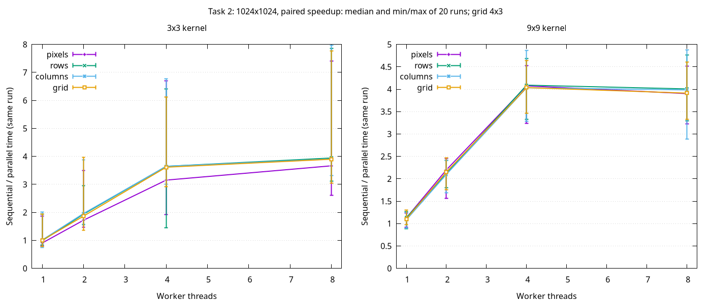

# Свёртка изображений

Реализация [задания][assignment].
Для чтения, перевода в оттенки серого и записи PNG используется [stb][stb].

## Задача 1: последовательная свёртка

### Запуск

```sh
make
./build/convolve examples/hopper.jpg edge build/result.png
```

Аргументы: входное изображение, название фильтра, выходной PNG. Доступны `identity`, `blur`, `gaussian`, `sharpen`, `edge`; все ядра 3×3.

| Исходное изображение | Результат `edge` |
| --- | --- |
|  |  |

Фото: James S. Davis, U.S. Navy, [Wikimedia Commons][photo], public domain.

### Алгоритм

Для каждого пикселя суммируются произведения соседних пикселей и коэффициентов ядра без его разворота. Границы циклические; сумма ограничивается диапазоном 0–255 и округляется.

### Тесты

```sh
make test
make sanitize
make tidy
```

Форматирование: `make format`; проверка без изменения файлов: `make format-check`.
Нужны clang-format для C и [Ruff](https://docs.astral.sh/ruff/formatter/) для Python.

### Измерения

```sh
make benchmark
make benchmark-save
```

Сохранённые результаты меняются только по `benchmark-save`. После сохранения нового замера нужно обновить численные выводы ниже.


При увеличении изображения с 1024² до 2048² время растёт в 3,93–4,04 раза, примерно пропорционально числу пикселей. На изображении 2048² переход от 3×3 к 9×9 увеличивает время в 6,63 раза при девятикратном числе коэффициентов.

Размах относительно медианы — 1,66–5,70%. Процесс не закреплялся за конкретным ядром CPU; частота CPU и фоновая нагрузка не контролировались. [Исходные замеры](bench/results/sequential/results.csv), [медианы и разброс](bench/results/sequential/summary.csv), [окружение](bench/results/sequential/environment.txt).

## Задача 2: параллельная свёртка

### Запуск

```sh
./build/convolve examples/hopper.jpg edge build/rows.png rows 4
./build/convolve examples/hopper.jpg edge build/grid.png grid 4 5 3
```

После выходного файла задаются схема и число потоков; для `grid` — число столбцов и строк сетки. Без этих аргументов выполняется последовательная версия.

### Алгоритм

`pixels` распределяет пиксели циклически, `rows` и `columns` — непрерывные полосы, `grid` — прямоугольные плитки. Каждый пиксель записывает один поток; вход и ядро общие. Циклические границы, порядок суммирования и округление совпадают с задачей 1.

### Тесты

```sh
make test
make tsan-parallel
make sanitize
```

### Измерения

`make benchmark-parallel` готовит отчёт в `build/bench/parallel`; `make benchmark-save-parallel` сохраняет его в `bench/results/parallel`. После сохранения нового замера нужно обновить численные выводы ниже. Параметры: изображения 512²/1024², ядра 3×3/9×9, 1/2/4/8 потоков, сетка 4×3; один прогрев и 20 повторов. Измеряется вызов свёртки с запуском и ожиданием потоков. До таймера выход заполняется дополнением эталона, после вызова все пиксели сравниваются с последовательным результатом. График показывает медиану и min/max отношений serial/parallel с одинаковым `run`.



[Замеры](bench/results/parallel/results.csv), [сводка](bench/results/parallel/summary.csv), [окружение](bench/results/parallel/environment.txt).

Для 1024² минимальные медианы времени в этом запуске:

- 3×3: `columns`, 8 потоков, 8.60 мс, медиана ускорения 3.91×.
- 9×9: `rows`, 4 потока, 62.36 мс, медиана ускорения 4.09×.

[assignment]: https://docs.google.com/document/d/1V8V7dbDwUxXMPEF70KdU89kXn_cb95D4CJmDlrBSw_Y/edit

[stb]: vendor/stb/README.md

[photo]: https://commons.wikimedia.org/wiki/File:Grace_Hopper.jpg
