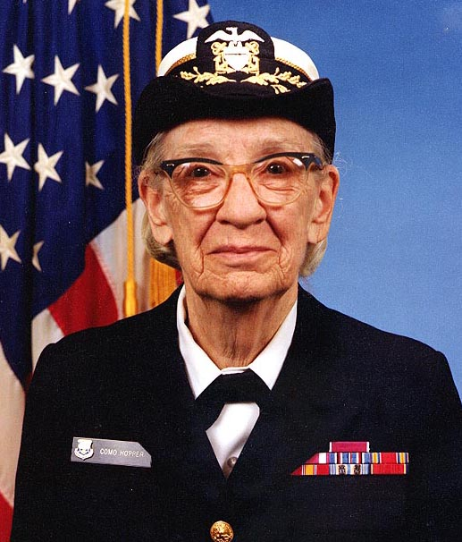
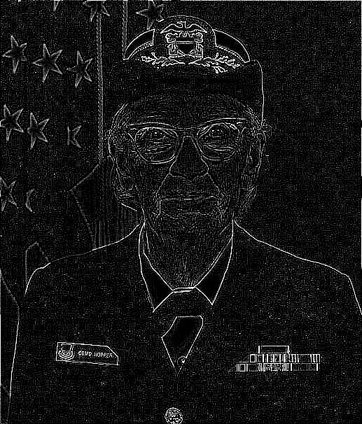
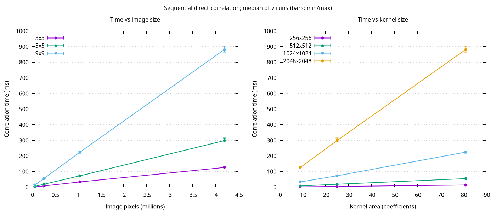

# Свёртка изображений

Реализация [задания][assignment].
Для чтения, перевода в оттенки серого и записи PNG используется [stb][stb].

## Задача 1: последовательная свёртка

### Запуск

```sh
make
./build/convolve examples/hopper.jpg edge build/result.png
```

Аргументы: входное изображение, название фильтра, выходной PNG. Доступны `identity`, `blur`, `gaussian`, `sharpen`, `edge`; все ядра 3×3.

| Исходное изображение | Результат `edge` |
| --- | --- |
|  |  |

Фото: James S. Davis, U.S. Navy, [Wikimedia Commons][photo], public domain.

### Алгоритм

Для каждого пикселя суммируются произведения соседних пикселей и коэффициентов ядра без его разворота. Границы циклические; сумма ограничивается диапазоном 0–255 и округляется.

### Тесты

```sh
make test
make sanitize
make tidy
```

Форматирование: `make format`; проверка без изменения файлов: `make format-check`.
Нужны clang-format для C и [Ruff](https://docs.astral.sh/ruff/formatter/) для Python.

### Измерения

```sh
make benchmark
make benchmark-save
```

Сохранённые результаты меняются только по `benchmark-save`. После сохранения нового замера нужно обновить численные выводы ниже.



При увеличении изображения с 1024² до 2048² время растёт в 3,75–4,10 раза, примерно пропорционально числу пикселей. На изображении 2048² переход от 3×3 к 9×9 увеличивает время в 6,98 раза при девятикратном числе коэффициентов.

Размах относительно медианы — 1,17–12,45%. Процесс не закреплялся за конкретным ядром CPU; частота CPU и фоновая нагрузка не контролировались. [Исходные замеры](bench/results/sequential/results.csv), [медианы и разброс](bench/results/sequential/summary.csv), [окружение](bench/results/sequential/environment.txt).

[assignment]: https://docs.google.com/document/d/1V8V7dbDwUxXMPEF70KdU89kXn_cb95D4CJmDlrBSw_Y/edit

[stb]: vendor/stb/README.md

[photo]: https://commons.wikimedia.org/wiki/File:Grace_Hopper.jpg
